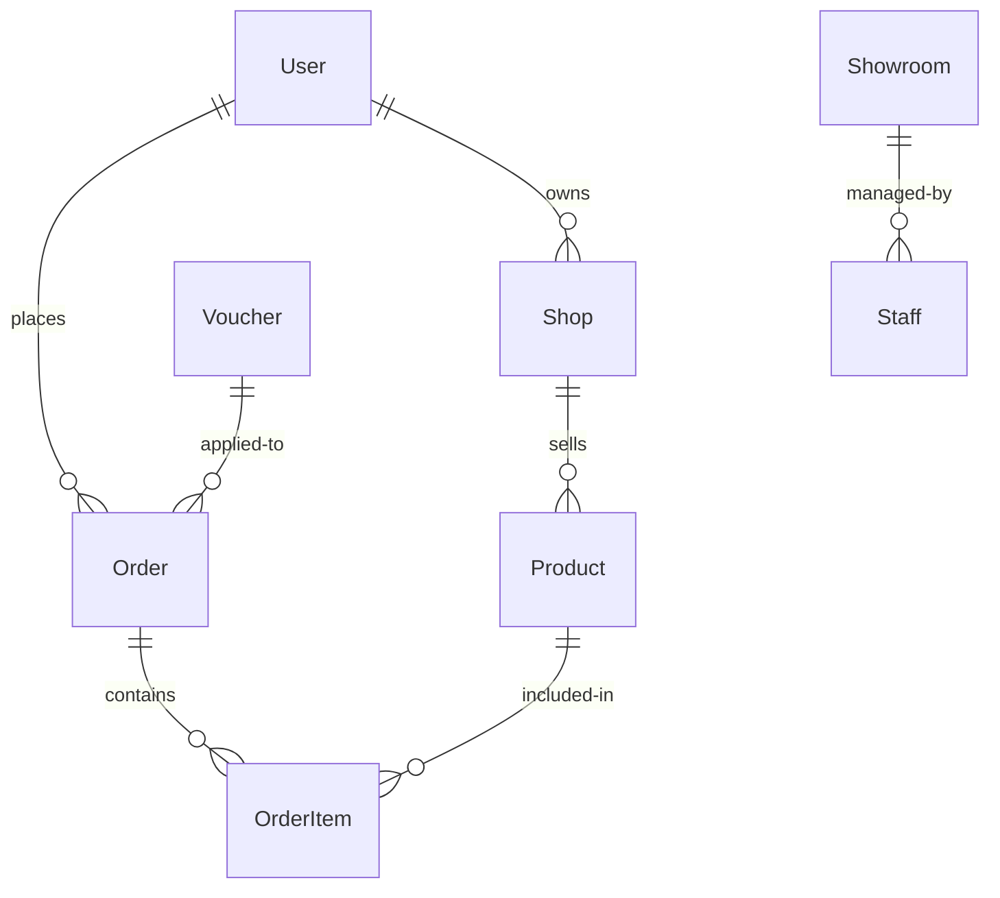
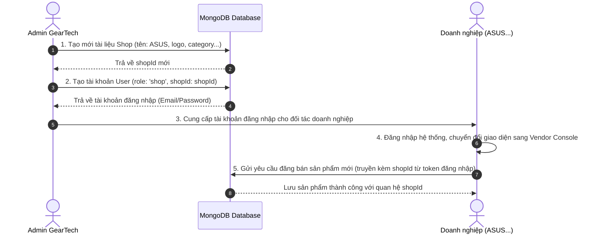

# Thiết kế Cơ sở dữ liệu GearTech (MongoDB & Express.js)

Tài liệu này định nghĩa cấu trúc cơ sở dữ liệu NoSQL (MongoDB) cho dự án thương mại điện tử **GearTech**. Việc triển khai sử dụng thư viện **Mongoose ODM** trên môi trường **Express.js (Node.js)**.

---

## 1. Sơ đồ Quan hệ Thực thể (ER Diagram)

Dưới đây là sơ đồ quan hệ giữa các Collection chính trong MongoDB:



---

## 2. Chi tiết các Collections & Mongoose Schemas

### 2.1. Collection: `users` (Người dùng)
Lưu trữ thông tin tài khoản, điểm thưởng thành viên, hạng thành viên và danh sách địa chỉ giao hàng.

```javascript
const mongoose = require('mongoose');

const AddressSchema = new mongoose.Schema({
  title: { type: String, default: 'Nhà riêng' }, // Văn phòng, Nhà riêng...
  receiverName: { type: String, required: true },
  receiverPhone: { type: String, required: true },
  detailAddress: { type: String, required: true },
  isDefault: { type: Boolean, default: false }
});

const UserSchema = new mongoose.Schema({
  name: { type: String, required: true, trim: true },
  email: { type: String, required: true, unique: true, lowercase: true, trim: true },
  password: { type: String, required: true }, // Mật khẩu đã được mã hóa (bcrypt)
  phone: { type: String, trim: true },
  avatar: { type: String, default: 'https://images.unsplash.com/photo-1534528741775-53994a69daeb?auto=format&fit=crop&w=150&q=80' },
  gender: { type: String, enum: ['Nam', 'Nữ', 'Khác'], default: 'Khác' },
  birthday: { type: Date },
  role: { type: String, enum: ['user', 'admin', 'shop'], default: 'user' }, // 'shop' dành cho tài khoản doanh nghiệp đăng bán
  shopId: { type: mongoose.Schema.Types.ObjectId, ref: 'Shop', default: null }, // Liên kết tới Shop (chỉ dành cho tài khoản doanh nghiệp)
  memberRank: { type: String, enum: ['THUONG', 'DONG', 'BAC', 'VANG', 'KIM_CUONG'], default: 'THUONG' },
  points: { type: Number, default: 0, min: 0 },
  addresses: [AddressSchema]
}, { timestamps: true });

// Đánh chỉ mục (Index) để tìm kiếm nhanh
UserSchema.index({ email: 1 });
UserSchema.index({ role: 1 });

module.exports = mongoose.model('User', UserSchema);
```

---

### 2.2. Collection: `shops` (Đối tác liên minh)
Lưu trữ thông tin các thương hiệu/cửa hàng phân phối sản phẩm trên nền tảng GearTech (như Apple Mall, ASUS ROG Zone...).

```javascript
const mongoose = require('mongoose');

const ShopSchema = new mongoose.Schema({
  name: { type: String, required: true, unique: true, uppercase: true, trim: true },
  logo: { type: String, required: true }, // Emoji đại diện hoặc link ảnh logo
  category: { type: String, required: true }, // Lĩnh vực hoạt động (VD: 'MacBook & Apple Ecosystem')
  rating: { type: Number, default: 5.0, min: 0, max: 5 },
  followers: { type: String, default: '0' }, // Số lượng người theo dõi (định dạng text như '450K')
  bgClass: { type: String }, // CSS background style cho giao diện
  ownerId: { type: mongoose.Schema.Types.ObjectId, ref: 'User', required: true }
}, { timestamps: true });

module.exports = mongoose.model('Shop', ShopSchema);
```

---

### 2.3. Collection: `products` (Sản phẩm High-Tech)
Lưu trữ toàn bộ danh sách thiết bị công nghệ kèm thông số kỹ thuật, đánh giá và cửa hàng phân phối.

```javascript
const mongoose = require('mongoose');

const ProductSchema = new mongoose.Schema({
  title: { type: String, required: true, trim: true, uppercase: true },
  description: { type: String, required: true },
  price: { type: Number, required: true, min: 0 },
  oldPrice: { type: Number, min: 0 },
  discount: { type: String }, // VD: '12%'
  imageEmoji: { type: String, required: true }, // Emoji hiển thị nhanh hoặc link ảnh đại diện
  gallery: [{ type: String }], // Danh sách emoji hoặc URL ảnh thư viện
  category: { 
    type: String, 
    required: true, 
    enum: ['laptops', 'desktops', 'brand', 'components', 'monitors', 'peripherals', 'audio', 'smart-devices', 'accessories'] 
  },
  categoryName: { type: String, required: true }, // Tên danh mục hiển thị (VD: 'LAPTOP & MACBOOK')
  rating: { type: Number, default: 5.0, min: 0, max: 5 },
  reviewsCount: { type: Number, default: 0 },
  salesCount: { type: String, default: 'ĐÃ BÁN 0' }, // VD: 'ĐÃ BÁN 1.2K'
  stock: { type: Number, required: true, default: 10, min: 0 },
  shopId: { type: mongoose.Schema.Types.ObjectId, ref: 'Shop', required: true },
  
  // Thông số kỹ thuật động (Dynamic Technical Specs)
  specs: {
    type: Map,
    of: String
  }
}, { timestamps: true });

// Đánh chỉ mục tìm kiếm văn bản (Text Search Index) cho tìm kiếm sản phẩm
ProductSchema.index({ title: 'text', description: 'text' });
ProductSchema.index({ category: 1 });

module.exports = mongoose.model('Product', ProductSchema);
```

---

### 2.4. Collection: `orders` (Đơn hàng)
Quản lý lịch sử mua hàng, trạng thái thanh toán và quá trình giao hàng.

```javascript
const mongoose = require('mongoose');

const OrderItemSchema = new mongoose.Schema({
  productId: { type: mongoose.Schema.Types.ObjectId, ref: 'Product', required: true },
  title: { type: String, required: true },
  qty: { type: Number, required: true, min: 1 },
  price: { type: Number, required: true, min: 0 }
});

const OrderSchema = new mongoose.Schema({
  userId: { type: mongoose.Schema.Types.ObjectId, ref: 'User', required: true },
  items: [OrderItemSchema],
  totalAmount: { type: Number, required: true, min: 0 },
  shippingAddress: {
    receiverName: { type: String, required: true },
    receiverPhone: { type: String, required: true },
    detailAddress: { type: String, required: true }
  },
  paymentMethod: { type: String, enum: ['COD', 'MOMO', 'VNPAY', 'BANK_TRANSFER'], required: true },
  paymentStatus: { type: String, enum: ['Pending', 'Paid', 'Failed'], default: 'Pending' },
  orderStatus: { 
    type: String, 
    enum: ['pending', 'processing', 'shipping', 'completed', 'cancelled'], 
    default: 'pending' 
  },
  voucherCode: { type: String }
}, { timestamps: true });

OrderSchema.index({ userId: 1 });
OrderSchema.index({ orderStatus: 1 });

module.exports = mongoose.model('Order', OrderSchema);
```

---

### 2.5. Collection: `vouchers` (Mã giảm giá)
Quản lý các mã khuyến mãi dành cho thành viên của GearTech.

```javascript
const mongoose = require('mongoose');

const VoucherSchema = new mongoose.Schema({
  code: { type: String, required: true, unique: true, uppercase: true, trim: true },
  description: { type: String, required: true },
  discountValue: { type: Number, required: true, min: 0 }, // Số tiền giảm giá cố định (VND)
  minOrderValue: { type: Number, default: 0, min: 0 }, // Giá trị đơn hàng tối thiểu áp dụng
  expiryDate: { type: Date, required: true },
  maxUses: { type: Number, default: 100 }, // Số lần tối đa mã có thể sử dụng
  usesCount: { type: Number, default: 0 } // Số lần đã được sử dụng
}, { timestamps: true });

module.exports = mongoose.model('Voucher', VoucherSchema);
```

---

### 2.6. Collection: `showrooms` (Hệ thống cửa hàng Google Map)
Quản lý danh sách các địa chỉ showroom của GearTech hiển thị trên Google Map.

```javascript
const mongoose = require('mongoose');

const ShowroomSchema = new mongoose.Schema({
  name: { type: String, required: true, trim: true, uppercase: true },
  address: { type: String, required: true },
  phone: { type: String, required: true },
  hours: { type: String, required: true }, // Giờ mở cửa (VD: '08:00 - 22:00')
  features: [{ type: String }], // Tiện ích độc quyền tại showroom
  lat: { type: Number, required: true }, // Tọa độ vĩ độ (Latitude)
  lng: { type: Number, required: true }, // Tọa độ kinh độ (Longitude)
  city: { type: String, enum: ['hcm', 'hanoi', 'danang'], required: true },
  mapUrl: { type: String, required: true } // Iframe Embed Url từ Google Map
}, { timestamps: true });

module.exports = mongoose.model('Showroom', ShowroomSchema);
```

---

## 3. Gợi ý cấu hình Kết nối MongoDB trong Express.js

Trong dự án Express.js của bạn, hãy sử dụng đoạn mã sau để kết nối an toàn với MongoDB Atlas hoặc Localhost:

```javascript
const express = require('express');
const mongoose = require('mongoose');
require('dotenv').config();

const app = express();
app.use(express.json());

// Kết nối MongoDB
const MONGODB_URI = process.env.MONGODB_URI || 'mongodb://localhost:27017/geartech';

mongoose.connect(MONGODB_URI)
  .then(() => console.log('✅ Kết nối cơ sở dữ liệu MongoDB thành công!'))
  .catch((err) => console.error('❌ Lỗi kết nối MongoDB:', err));

const PORT = process.env.PORT || 5000;
app.listen(PORT, () => {
  console.log(`🚀 Server backend đang chạy trên cổng ${PORT}`);
});
```

---

## 4. Quy trình kết nối và cấp quyền Đăng bán cho Doanh nghiệp (Multi-vendor Flow)

Khi một doanh nghiệp công nghệ (ví dụ: ASUS, Razer...) muốn tham gia làm đối tác liên minh đăng bán trên nền tảng GearTech, quy trình thiết lập tài khoản sẽ diễn ra qua các bước sau để đảm bảo bảo mật và nhất quán dữ liệu:



### 4.1. Chi tiết thực thi nghiệp vụ phía Backend

1. **Bước 1: Admin tạo đối tác Shop trước:**
   Tạo tài liệu mới trong collection `shops` để lấy được ID đại diện của gian hàng:
   ```json
   {
     "_id": "60c72b2f9b1d8b2bad123456", // shopId
     "name": "ASUS VIETNAM",
     "logo": "👹",
     "category": "ROG Laptop & Gaming Hardware",
     "followers": "0"
   }
   ```

2. **Bước 2: Admin tạo tài khoản người dùng gắn với Shop đó:**
   Tạo mới tài liệu trong collection `users` với `role: "shop"` và liên kết `shopId` vừa tạo:
   ```json
   {
     "name": "Đại diện ASUS Vietnam",
     "email": "partner.asus@gmail.com",
     "password": "hashed_password_from_admin",
     "role": "shop",
     "shopId": "60c72b2f9b1d8b2bad123456",
     "memberRank": "THUONG"
   }
   ```

3. **Bước 3: Cơ chế đăng bán sản phẩm (Post Product API):**
   * Khi đối tác đăng nhập bằng tài khoản `partner.asus@gmail.com`, phía Backend sẽ tạo ra một JWT chứa thông tin `userId`, `role`, và `shopId`.
   * Khi đối tác gọi API `POST /api/products` để đăng bán một sản phẩm mới, Middleware xác thực của Backend sẽ kiểm tra:
     * Nếu `req.user.role !== 'shop'` hoặc `!req.user.shopId` $\rightarrow$ Trả về mã lỗi `403 Forbidden` (Chỉ tài khoản doanh nghiệp liên kết mới được đăng bán).
     * Nếu hợp lệ, tự động gán `shopId` của sản phẩm bằng `req.user.shopId` của tài khoản đang đăng nhập để tránh việc shop này đăng bán sản phẩm dưới tên của shop khác.
     
   Đoạn mã ví dụ cho API đăng bán phía Express.js:
   ```javascript
   // Route: POST /api/products
   // Middleware auth sẽ kiểm tra token và gán user vào req.user
   app.post('/api/products', auth, async (req, res) => {
     try {
       // Kiểm tra phân quyền
       if (req.user.role !== 'shop' || !req.user.shopId) {
         return res.status(403).json({ error: 'Chỉ tài khoản đối tác doanh nghiệp được phép đăng bán sản phẩm.' });
       }
       
       const { title, description, price, category, categoryName, imageEmoji, gallery, stock, specs } = req.body;
       
       const newProduct = new Product({
         title,
         description,
         price,
         category,
         categoryName,
         imageEmoji,
         gallery,
         stock,
         specs,
         shopId: req.user.shopId // Tự động lấy ID shop từ thông tin đăng nhập
       });
       
       await newProduct.save();
       res.status(201).json({ message: 'Đăng bán sản phẩm thành công!', product: newProduct });
     } catch (err) {
       res.status(500).json({ error: 'Lỗi máy chủ khi đăng bán sản phẩm.', details: err.message });
     }
   });
   ```
