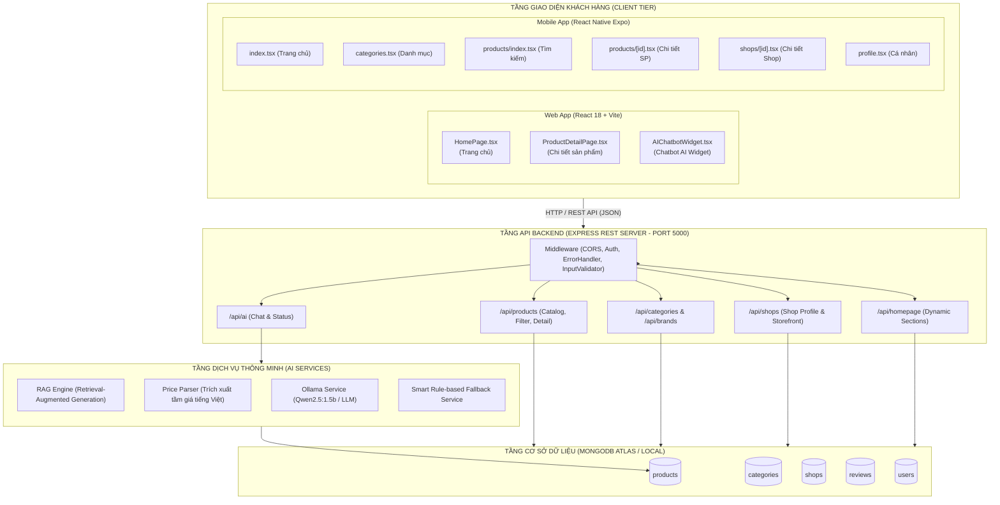
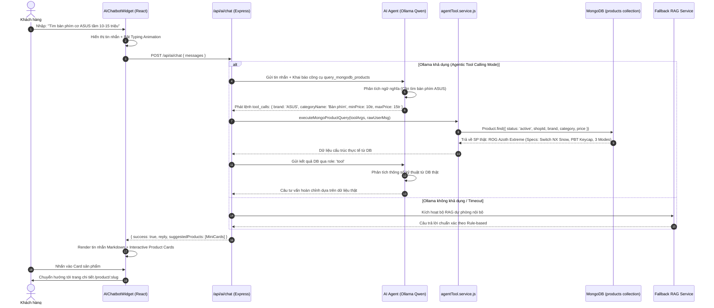
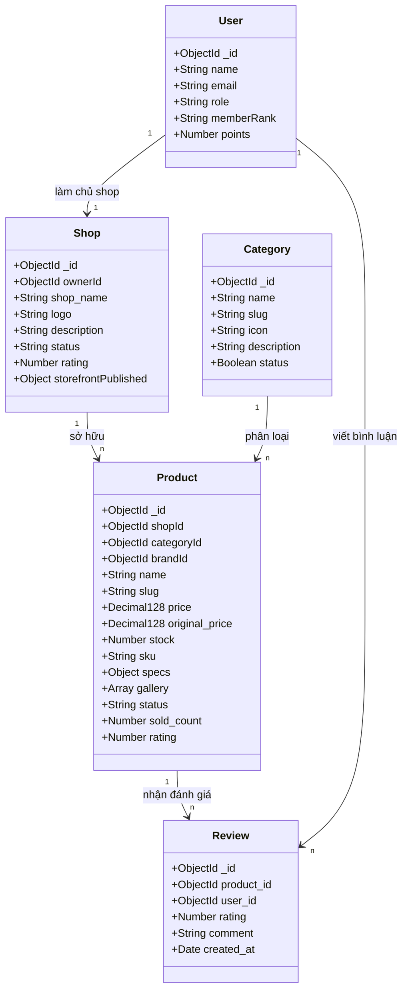

# HƯỚNG DẪN CHI TIẾT LUỒNG CODE & KIẾN TRÚC HỆ THỐNG
## DÀNH CHO: BÙI VIẾT KHÁNH – NHÓM TRƯỞNG DỰ ÁN GEARTECH

---

## MỤC LỤC
1. [Tổng quan Phạm vi Phụ trách](#1-tổng-quan-phạm-vi-phụ-trách)
2. [Sơ đồ Kiến trúc Tổng thể Hệ thống](#2-sơ-đồ-kiến-trúc-tổng-thể-hệ-thống)
3. [Phân hệ 1: Trợ lý AI Tư vấn Mua sắm Thông minh (AI Shopping Advisor)](#3-phân-hệ-1-trợ-lý-ai-tư-vấn-mua-sắm-thông-minh)
4. [Phân hệ 2: Web – Trang Chủ Marketplace (Homepage)](#4-phân-hệ-2-web--trang-chủ-marketplace)
5. [Phân hệ 3: Web – Trang Chi Tiết Sản Phẩm (Product Detail Page)](#5-phân-hệ-3-web--trang-chi-tiết-sản-phẩm)
6. [Phân hệ 4: App Mobile – 6 Màn hình Cốt lõi (React Native Expo)](#6-phân-hệ-4-app-mobile--6-màn-hình-cốt-lõi)
7. [Database Models & Quan hệ CSDL Liên quan](#7-database-models--quan-hệ-csdl-liên-quan)
8. [Bảng Tra Cứu Nhanh Endpoint API & File Nguồn](#8-bảng-tra-cứu-nhanh-endpoint-api--file-nguồn)
9. [Bộ Câu Hỏi & Trả Lời Vấn Đáp Kỹ Thuật (Defense Cheat Sheet)](#9-bộ-câu-hỏi--trả-lời-vấn-đáp-kỹ-thuật)

---

## 1. TỔNG QUAN PHẠM VI PHỤ TRÁCH

Theo phân công trong file `PhanCong_GearTech.xlsx`, vai trò của **Bùi Viết Khánh** là **Nhóm trưởng** (Team Leader), phụ trách các module công nghệ cao và giao diện người dùng chính:

* **Trí tuệ nhân tạo (AI Web)**: Module Trợ lý AI tư vấn mua sắm phần cứng, chatbot thông minh RAG kết nối mô hình LLM (Ollama / Qwen2.5) với CSDL sản phẩm MongoDB.
* **Giao diện Web Khách hàng (Web Client)**:
  * **Trang chủ (`/`, `/Trang-chu`)**: Banner video, danh mục tương tác, khối Flash Sale, sản phẩm thịnh hành, gian hàng nổi bật.
  * **Trang Chi tiết sản phẩm (`/product/:id`)**: Thư viện ảnh gallery, bảng thông số kỹ thuật (specs), đánh giá (reviews), giỏ hàng và gợi ý sản phẩm từ AI.
* **Ứng dụng Di động (Mobile App - React Native Expo)**: Trọn bộ 6 màn hình giao diện khách hàng cốt lõi:
  1. Trang chủ (`app/(tabs)/index.tsx`)
  2. Danh mục (`app/(tabs)/categories.tsx`)
  3. Tìm kiếm & Danh sách sản phẩm (`app/products/index.tsx`)
  4. Chi tiết sản phẩm (`app/products/[id].tsx`)
  5. Chi tiết cửa hàng (`app/shops/[id].tsx`)
  6. Cá nhân & Tài khoản (`app/(tabs)/profile.tsx`)

---

## 2. SƠ ĐỒ KIẾN TRÚC TỔNG THỂ HỆ THỐNG



---

## 3. PHÂN HỆ 1: TRỢ LÝ AI TƯ VẤN MUA SẮM THÔNG MINH

### 3.1. Luồng hoạt động Tổng quát (Agentic AI Tool Calling & RAG Architecture)
Hệ thống AI Advisor của GearTech áp dụng kiến trúc **AI Agent Tool Calling (Function Calling)** hiện đại nhất hiện nay kết hợp với **RAG (Retrieval-Augmented Generation)**:

1. **Khách hàng đặt câu hỏi**: Từ Widget nổi trên website hoặc qua mobile app (VD: *"Tìm cho tôi bàn phím cơ ASUS tầm 10-15 triệu"*).
2. **AI suy nghĩ và phát lệnh Tool Calling (Agentic Reasoning)**:
   - Node.js cung cấp cho mô hình LLM công cụ `query_mongodb_products({ categoryName, keyword, brand, minPrice, maxPrice })`.
   - Mô hình AI (Qwen) tự phân tích ý định của khách:
     * Nếu là **câu hỏi tìm kiếm / tư vấn phần cứng**: AI **tự động phát lệnh gọi Tool (`tool_calls`)** với các tham số do chính AI tính toán (Ví dụ: `categoryName: 'Bàn phím'`, `brand: 'ASUS'`, `minPrice: 10000000`, `maxPrice: 15000000`).
     * Nếu là **chào hỏi xã giao / cảm ơn**: AI tự trả lời trực tiếp mà không cần truy vấn Database.
3. **Thực thi truy vấn dữ liệu thực tế từ MongoDB (`agentTool.service.js`)**:
   - Node.js nhận tham số từ AI và thực thi câu truy vấn MongoDB:
     * Kiểm tra trạng thái hoạt động của gian hàng (`shopId in activeShops`).
     * Lọc theo khoảng giá chuẩn hóa (kết hợp `priceParser.js` xử lý tiếng Việt).
     * Bóc tách các thông số kỹ thuật chi tiết (`specs` & `specifications`: Switch cơ, DPI, Keycap, Tấm nền, Tần số quét, Kết nối...).
4. **Phân tích kỹ thuật & Trả lời khách hàng (Grounding - Không bịa đặt)**:
   - Dữ liệu sản phẩm thực tế từ MongoDB được đưa ngược lại cho AI dưới dạng `role: 'tool'`.
   - AI đọc dữ liệu MongoDB thật, phân tích các thông số kỹ thuật (Switch cơ học ROG NX Snow, Keycap PBT, kết nối 3 chế độ...) để giải thích lý do tại sao khách nên mua.
   - Do AI chỉ được tư vấn dựa trên danh sách DB thực tế trả về, hệ thống **triệt tiêu 100% hiện tượng Hallucination (AI bịa thông tin/giá ảo)**.
5. **Chế độ Dự phòng Thông minh (Fallback RAG Resilience)**:
   - Nếu máy chủ Ollama ngoại tuyến hoặc quá tải: Hệ thống tự động chuyển sang `fallback.service.js` để trả lời dựa trên thuật toán tính điểm và luật nghiệp vụ mà không làm gián đoạn trải nghiệm người dùng.
6. **Frontend hiển thị**: Render tin nhắn chat định dạng markdown kèm các **Mini Product Cards** tương tác (có ảnh, giá, nút xem chi tiết và thêm vào giỏ).

### 3.2. Sơ đồ Tuần tự AI Tool Calling (Sequence Diagram)


### 3.3. Các file mã nguồn cốt lõi:
* **Frontend**:
  * `FrontEnd/src/components/common/AIChatbotWidget.tsx`: Giao diện chatbot nổi góc màn hình, quản lý state tin nhắn, typing animation, cuộn tự động và render thẻ sản phẩm gợi ý.
  * `FrontEnd/src/services/aiService.ts`: Chứa hàm `sendMessage(messages, productId)` và `checkStatus()`.
* **Backend**:
  * `Backend/routes/ai/ai.routes.js`: Định tuyến `GET /status`, `POST /chat`.
  * `Backend/routes/ai/ai.controller.js`: Tiếp nhận request, gọi service và xử lý lỗi.
  * `Backend/routes/ai/services/aiChat.service.js`: Bộ điều phối AI Agent Orchestrator (quản lý 2 bước Tool Calling & Fallback).
  * `Backend/routes/ai/services/agentTool.service.js`: Định nghĩa Tool và thực thi câu truy vấn MongoDB Mongoose thực tế an toàn.
  * `Backend/routes/ai/services/ollama.service.js`: Giao tiếp HTTP với máy chủ Ollama cục bộ, hỗ trợ truyền danh sách `tools` và nhận `tool_calls`.
  * `Backend/routes/ai/services/productRecommendation.service.js`: Thuật toán lọc và trích xuất thông số kỹ thuật chi tiết.
  * `Backend/routes/ai/services/fallback.service.js`: Sinh phản hồi dự phòng thông minh kèm thông số kỹ thuật khi LLM offline.
  * `Backend/routes/ai/utils/priceParser.js`: Trích xuất số tiền và khoảng giá (khoảng giữa 2 số, tối đa, tối thiểu) bằng Regular Expression tiếng Việt.

---

## 4. PHÂN HỆ 2: WEB – TRANG CHỦ MARKETPLACE (HOMEPAGE)

### 4.1. Luồng dữ liệu và Hiển thị (Data Flow)
```
[Client Mount: HomePage.tsx]
       │
       ├──> Promise.all:
       │     ├─> productService.getProducts() ───────> GET /api/products
       │     ├─> categoryService.getCategories() ────> GET /api/categories
       │     ├─> shopService.getShops() ─────────────> GET /api/shops
       │     └─> homepageService.getPublished() ─────> GET /api/homepage
       │
       ▼
[State Management]:
 - allProducts (Danh sách toàn bộ sản phẩm)
 - featuredShops (Các cửa hàng uy tín được ghim)
 - publishedSections (Các khối giao diện Admin cấu hình qua Homepage Builder)
       │
       ▼
[Render Layout]:
 1. Hero Banner: Background Video Loop (assets/video/BackgroundLoop.mp4) + Gaming Laptop Poster
 2. Category Navigation Bar: Bộ lọc tab danh mục tức thì (GPU, Laptop, Bàn phím, Màn hình...)
 3. Flash Sale Section: Đồng hồ đếm ngược Live Countdown + Thẻ sản phẩm giảm giá sốc
 4. Dynamic Sections: Render linh hoạt theo thứ tự Admin cấu hình (Bán chạy, Mới về, Nổi bật)
 5. Official Stores: Gian hàng đối tác uy tín kèm logo, đánh giá sao và số lượng sản phẩm
```

### 4.2. Các tính năng kỹ thuật nổi bật:
* **Video Loop Nền tối ưu**: Sử dụng thẻ HTML5 `<video autoPlay loop muted playsInline>` kết hợp lớp overlay gradient để tạo phong cách Dark Gaming đặc trưng.
* **Bộ lọc tức thì tại trang chủ**: Lọc sản phẩm theo danh mục (`activeCategoryFilter`) ngay trên client state, không cần tải lại trang.
* **Thêm nhanh vào giỏ hàng**: Tích hợp trực tiếp với Zustand store (`useCartStore.getState().addItem(product)`), hiển thị toast thông báo thành công và cập nhật badge giỏ hàng trên Header.
* **Tương thích Homepage Builder**: Nhận dữ liệu cấu hình từ collection `homepageconfigs` để bật/tắt và sắp xếp thứ tự các section theo thời gian thực.

### 4.3. File mã nguồn cốt lõi:
* `FrontEnd/src/features/home/pages/HomePage.tsx`: Toàn bộ logic giao diện trang chủ.
* `FrontEnd/src/services/productService.ts`: Gọi API catalog sản phẩm.
* `FrontEnd/src/services/homepageService.ts`: Tải cấu hình giao diện xuất bản.
* `Backend/routes/products.js`: Xử lý truy vấn danh sách sản phẩm với các bộ lọc `category`, `featured`, `limit`, `sort`.

---

## 5. PHÂN HỆ 3: WEB – TRANG CHI TIẾT SẢN PHẨM (PRODUCT DETAIL PAGE)

### 5.1. Luồng xử lý chi tiết (Detailed Component Architecture)
Khi khách hàng truy cập `/product/:id` (hoặc `/product/:slug`):

```
                   ProductDetailPage.tsx
                             │
     ┌───────────────────────┼───────────────────────┐
     ▼                       ▼                       ▼
ProductGalleryViewer   ProductInfoActions      ProductShopCard
(Thư viện ảnh)         (Giá, Khuyến mãi,       (Hồ sơ gian hàng,
 - Ảnh chính zoom      - Badge giảm giá        - Nút theo dõi Shop
 - Slider thumbnails   - Bộ chọn số lượng      - Đánh giá uy tín
 - Fallback Emoji      - Thêm vào giỏ hàng     - Link tới Shop)
                       - Nút Mua ngay)
                             │
                             ▼
                    ProductTabsContent
                             │
     ┌───────────────────────┼───────────────────────┐
     ▼                       ▼                       ▼
Tab: Mô tả chi tiết    Tab: Thông số kỹ thuật  Tab: Đánh giá & Reviews
(Nội dung HTML/Text    (Bảng specs chuẩn hóa:  - Danh sách bình luận
từ người bán)          VRAM, CPU, Switch...)   - Điểm số sao trung bình
                                               - Form gửi đánh giá mới
```

### 5.2. Các cơ chế nghiệp vụ quan trọng:
1. **Chuẩn hóa Thông số Kỹ thuật (`productSpecsList`)**:
   - Backend hỗ trợ lưu specs dưới cả 3 dạng: `Array<{ name, value }>`, Mongoose `Map` hoặc `Object key-value`.
   - `ProductDetailPage.tsx` dùng `useMemo` tự động chuẩn hóa mọi định dạng về mảng đồng nhất `{ name, value }`, giúp bảng thông số kỹ thuật hiển thị chính xác mà không bao giờ bị lỗi crash ứng dụng.
2. **Quy trình Mua hàng & Thêm vào giỏ**:
   - Nhấn **"Thêm vào giỏ hàng"**: Gọi `addItem(product, quantity)`, hiển thị toast thông báo, giỏ hàng tự động đồng bộ lên server qua API `/api/cart/items`.
   - Nhấn **"Mua ngay"**: Thêm sản phẩm vào giỏ, gán `selected: true` và dùng `navigate('/checkout')` chuyển thẳng sang màn hình thanh toán.
3. **Tích hợp Đánh giá & Bình luận (`reviewService`)**:
   - Kiểm tra điều kiện đánh giá (`isEligibleReview`): Người dùng đã mua và nhận hàng thành công mới được gửi review.
   - Tính toán điểm đánh giá trung bình và cập nhật số sao của sản phẩm.

### 5.3. File mã nguồn cốt lõi:
* `FrontEnd/src/features/products/pages/ProductDetailPage.tsx`: Trang chủ đạo điều phối.
* `FrontEnd/src/features/products/components/ProductGalleryViewer.tsx`: Thư viện ảnh sản phẩm.
* `FrontEnd/src/features/products/components/ProductInfoActions.tsx`: Cụm giá, khuyến mãi và nút hành động.
* `FrontEnd/src/features/products/components/ProductShopCard.tsx`: Thẻ thông tin gian hàng sở hữu.
* `FrontEnd/src/features/products/components/ProductTabsContent.tsx`: Tab mô tả, thông số và đánh giá.
* `Backend/routes/reviews.js`: API bình luận, đánh giá sao.

---

## 6. PHÂN HỆ 4: APP MOBILE – 6 MÀN HÌNH CỐT LÕI (REACT NATIVE EXPO)

Ứng dụng di động được xây dựng bằng **React Native (Expo Router v58)**, sử dụng kiến trúc thư mục định tuyến dạng tệp (`file-based routing`) và kết nối trực tiếp với cùng một máy chủ Backend Node.js qua Axios interceptor.

```
mobile-app/app/
├── _layout.tsx                     # Root layout, Theme Provider, TanStack Query Client
├── (tabs)/
│   ├── _layout.tsx                 # Tab navigation bar (Trang chủ, Danh mục, Giỏ hàng, Cá nhân)
│   ├── index.tsx                   # [Màn 1] Trang chủ Mobile
│   ├── categories.tsx              # [Màn 2] Danh mục sản phẩm Mobile
│   └── profile.tsx                 # [Màn 6] Cá nhân & Hồ sơ tài khoản Mobile
├── products/
│   ├── index.tsx                   # [Màn 3] Tìm kiếm & Danh sách sản phẩm
│   └── [id].tsx                    # [Màn 4] Chi tiết sản phẩm Mobile
└── shops/
    └── [id].tsx                    # [Màn 5] Chi tiết cửa hàng & Hồ sơ shop
```

---

### 6.1. Màn hình 1: Trang chủ Mobile (`app/(tabs)/index.tsx`)
* **Chức năng**:
  * Thanh tìm kiếm nhanh `SearchBar` với focus ring, nút xóa từ khóa và gửi tìm kiếm.
  * Nút Giỏ hàng nhanh ở góc trên bên phải kèm Badge hiển thị số lượng sản phẩm realtime.
  * Danh mục ngang dạng tile bo góc (Horizontal Scroll) kèm hiệu ứng Skeleton loading khi đang tải.
  * Lưới 2 cột sản phẩm mới nhất (`ProductCard v2`) tải từ API `/api/products?sortBy=newest&limit=8`.
  * Hỗ trợ thao tác kéo xuống để làm mới (Pull-to-Refresh) bằng `RefreshControl`.

---

### 6.2. Màn hình 2: Danh mục sản phẩm Mobile (`app/(tabs)/categories.tsx`)
* **Chức năng**:
  * Hiển thị toàn bộ cây danh mục phần cứng linh kiện (GPU, CPU, Laptop, RAM, SSD, Gaming Gear...).
  * Mỗi danh mục đi kèm icon đặc trưng và số lượng sản phẩm hiện có.
  * Khi nhấn vào một danh mục, hệ thống điều hướng sang `products/index.tsx?category={slug}` để lọc sản phẩm thuộc danh mục đó.

---

### 6.3. Màn hình 3: Tìm kiếm & Danh sách sản phẩm (`app/products/index.tsx`)
* **Chức năng**:
  * Tiếp nhận tham số tìm kiếm từ thanh SearchBar hoặc Category Tile (`search`, `category`, `brand`).
  * Thanh công cụ lọc & sắp xếp: Giá tăng dần, Giá giảm dần, Mới nhất, Bán chạy nhất.
  * Hiển thị danh sách sản phẩm dạng lưới 2 cột hoặc danh sách dọc.
  * Xử lý các trạng thái rỗng (`EmptyView`) khi không tìm thấy kết quả và trạng thái lỗi mạng (`ErrorView`) kèm nút "Thử lại".

---

### 6.4. Màn hình 4: Chi tiết sản phẩm Mobile (`app/products/[id].tsx`)
* **Chức năng**:
  * Slider xem ảnh sản phẩm kích thước lớn hỗ trợ cử chỉ vuốt chạm (Swipe gesture).
  * Hiển thị thông tin giá bán, giá gốc gạch ngang, % tiết kiệm và trạng thái còn hàng/hết hàng.
  * Khối thông số kỹ thuật dạng bảng thu gọn (Collapsible specs table).
  * Khối thông tin gian hàng bán sản phẩm kèm nút "Ghé thăm shop".
  * Thanh công cụ chân trang cố định (Sticky Bottom Bar) gồm nút **"Thêm vào giỏ"** và **"Mua ngay"**.

---

### 6.5. Màn hình 5: Chi tiết cửa hàng Mobile (`app/shops/[id].tsx`)
* **Chức năng**:
  * Hiển thị ảnh Banner gian hàng, Logo đại diện, Tên shop và Huy hiệu chính hãng.
  * Thống kê độ uy tín của shop: Đánh giá trung bình (Rating 5.0), Tổng số sản phẩm, Số người theo dõi.
  * Tab danh mục sản phẩm do chính shop này phân phối.
  * Nút "Theo dõi shop" và nút "Chat tư vấn".

---

### 6.6. Màn hình 6: Cá nhân & Hồ sơ tài khoản (`app/(tabs)/profile.tsx`)
* **Chức năng**:
  * Đọc trạng thái xác thực từ `useAuthStore` (lưu trữ an toàn qua `SecureStore`).
  * Nếu chưa đăng nhập: Hiển thị banner mời đăng nhập/đăng ký.
  * Nếu đã đăng nhập: Hiển thị Avatar, Họ tên, Email, Cấp bậc thành viên (Đồng, Bạc, Vàng, Kim Cương) và Điểm thưởng tích lũy.
  * Các lối tắt quản lý nhanh: "Đơn mua của tôi", "Sổ địa chỉ nhận hàng", "Ví voucher ưu đãi", "Cài đặt tài khoản" và "Đăng xuất".

---

## 7. DATABASE MODELS & QUAN HỆ CSDL LIÊN QUAN



---

## 8. BẢNG TRA CỨU NHANH ENDPOINT API & FILE NGUỒN

Khi giảng viên hoặc hội đồng hỏi về bất kỳ chức năng nào, bạn có thể tra cứu ngay file mã nguồn tương ứng theo bảng dưới đây:

| Chức năng | Phương thức & URL API | File Controller / Route Backend | File Giao diện Frontend Web | File Giao diện Mobile App |
| :--- | :--- | :--- | :--- | :--- |
| **Kiểm tra trạng thái AI** | `GET /api/ai/status` | `Backend/routes/ai/ai.controller.js` | `FrontEnd/src/services/aiService.ts` | — |
| **Chat tư vấn thông minh (RAG)** | `POST /api/ai/chat` | `Backend/routes/ai/services/aiChat.service.js` | `components/common/AIChatbotWidget.tsx` | — |
| **Danh sách sản phẩm trang chủ** | `GET /api/products` | `Backend/routes/products.js` | `features/home/pages/HomePage.tsx` | `mobile-app/app/(tabs)/index.tsx` |
| **Cấu hình sections trang chủ** | `GET /api/homepage` | `Backend/routes/homepage.js` | `services/homepageService.ts` | — |
| **Cây danh mục linh kiện** | `GET /api/categories` | `Backend/routes/categories.js` | `services/categoryService.ts` | `mobile-app/app/(tabs)/categories.tsx` |
| **Chi tiết sản phẩm** | `GET /api/products/:id` | `Backend/routes/products.js` | `features/products/pages/ProductDetailPage.tsx` | `mobile-app/app/products/[id].tsx` |
| **Đánh giá & Bình luận** | `GET/POST /api/reviews` | `Backend/routes/reviews.js` | `components/ProductTabsContent.tsx` | — |
| **Chi tiết gian hàng** | `GET /api/shops/:id` | `Backend/routes/shops.js` | `features/stores/pages/ShopDetailPage.tsx` | `mobile-app/app/shops/[id].tsx` |
| **Tìm kiếm & Lọc sản phẩm** | `GET /api/products?search=...` | `Backend/routes/products.js` | `features/products/pages/ProductListPage.tsx` | `mobile-app/app/products/index.tsx` |
| **Thông tin cá nhân khách hàng** | `GET /api/auth/profile` | `Backend/routes/auth.js` | `features/profile/ProfilePage.tsx` | `mobile-app/app/(tabs)/profile.tsx` |

---

## 9. BỘ CÂU HỎI & TRẢ LỜI VẤN ĐÁP KỸ THUẬT (DEFENSE CHEAT SHEET)

### Câu 1: Trợ lý AI hoạt động như thế nào? Tại sao lại gọi là mô hình RAG?
> **Trả lời:**
> *"Trợ lý AI của GearTech sử dụng kiến trúc RAG (Retrieval-Augmented Generation - Tăng cường sinh văn bản bằng truy xuất dữ liệu). Khi người dùng hỏi một câu (ví dụ 'tư vấn card 15 triệu'), hệ thống không để mô hình AI tự bịa câu trả lời, mà thực hiện qua 3 bước:*
> 1. *Dùng `priceParser.js` và thuật toán keyword matching truy vấn vào MongoDB để lấy ra các sản phẩm thực tế đang còn hàng và đúng tầm giá.*
> 2. *Đóng gói dữ liệu sản phẩm này vào System Prompt để làm ngữ cảnh (Context).*
> 3. *Gửi Context cho mô hình LLM (Ollama Qwen2.5) sinh câu trả lời tự nhiên. Nếu Ollama tắt, hệ thống có `fallback.service.js` tự động sinh câu trả lời chuẩn xác theo luật dữ liệu, đảm bảo chatbot không bao giờ bị lỗi kết nối."*

### Câu 2: Trang Chi tiết sản phẩm hiển thị thông số kỹ thuật (Specs) phức tạp như thế nào?
> **Trả lời:**
> *"Do sản phẩm phần cứng công nghệ có thông số rất đa dạng (Card màn hình cần VRAM/PCIe, Bàn phím cần Switch/Layout, CPU cần Socket/Số nhân), Backend lưu specs dưới dạng Map/Object linh hoạt. Ở frontend `ProductDetailPage.tsx`, em dùng hook `useMemo` chuẩn hóa mọi dữ liệu về mảng đồng nhất `[{ name, value }]` để render bảng thông số kỹ thuật tự động co giãn và kiểm tra lọc bỏ các trường rỗng."*

### Câu 3: Làm thế nào để đồng bộ dữ liệu giữa Web và App Mobile?
> **Trả lời:**
> *"Cả ứng dụng Web React và ứng dụng Mobile React Native Expo đều giao tiếp chung với một Backend REST API Node.js/Express duy nhất (Port 5000) và một CSDL MongoDB tập trung. Mọi thay đổi về sản phẩm, giá bán, lượt xem và danh mục đều được phản ánh đồng thời trên cả hai nền tảng."*

### Câu 4: Trên Mobile App, bạn xử lý độ trễ mạng và trải nghiệm người dùng ra sao?
> **Trả lời:**
> *"Em sử dụng thư viện `@tanstack/react-query` để quản lý bộ nhớ đệm (Caching) và cơ chế Stale-While-Revalidate. Khi mạng yếu hoặc mất kết nối tạm thời, app vẫn hiển thị dữ liệu đã lưu đệm trước đó kèm bộ khung xương `Skeleton loader` mượt mà, đồng thời hỗ trợ kéo để làm mới (Pull-to-Refresh) khi có mạng trở lại."*

---
*Tài liệu được biên soạn đồng bộ với mã nguồn thực tế của dự án GEARTECH.*

